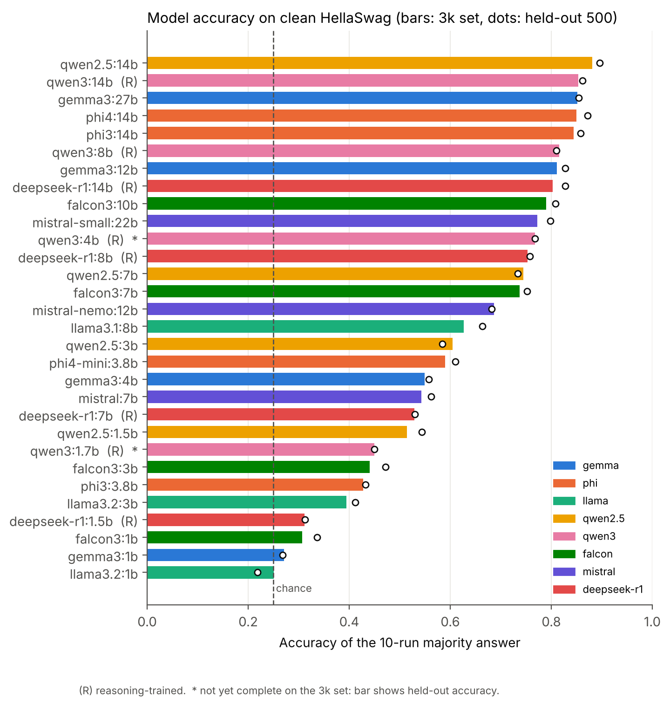
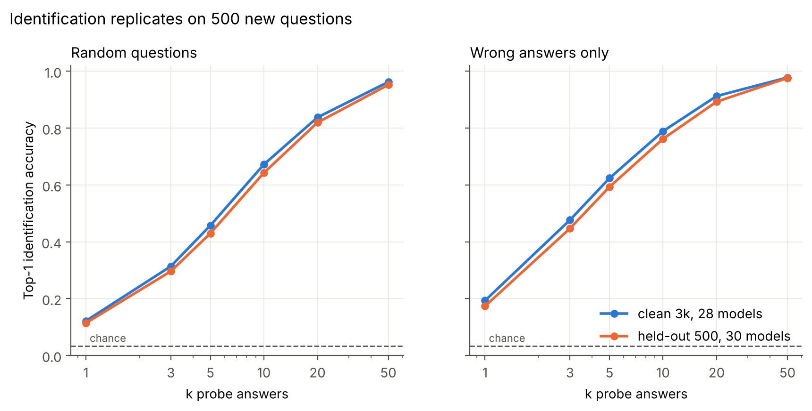
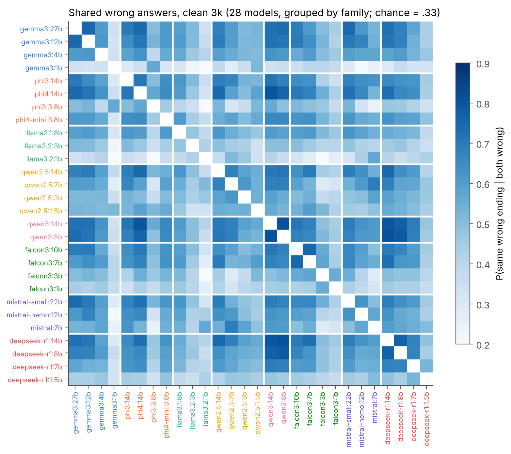
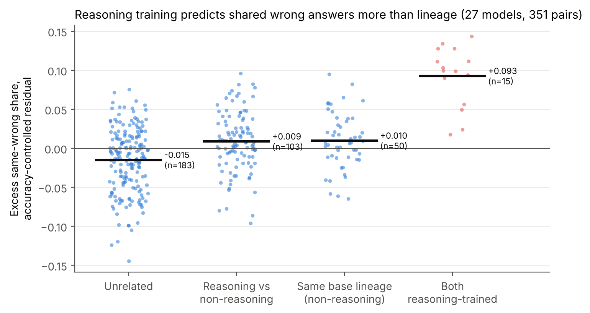
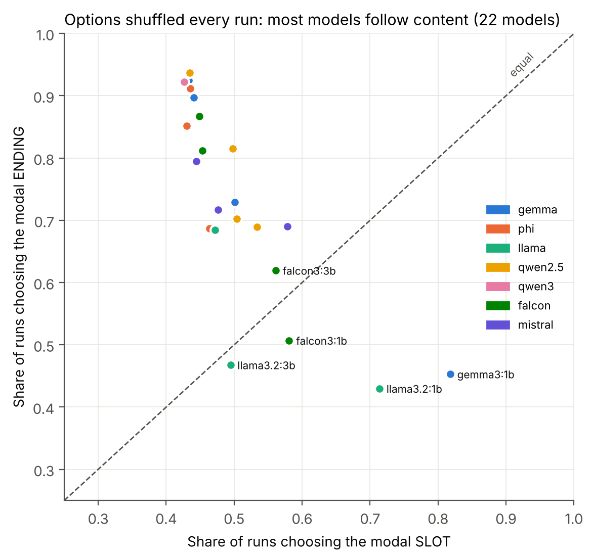
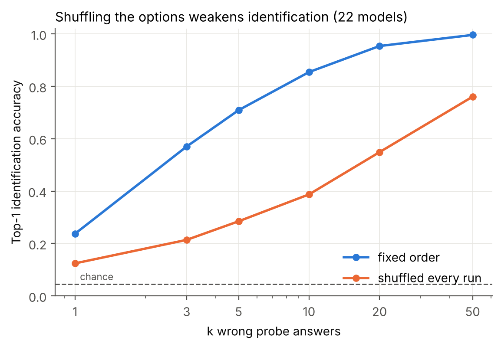

# LLM fingerprinting from multiple-choice answers

This project asks whether you can tell which open-weight LLM produced a set of answers to multiple-choice questions, and what makes two models give the same *wrong* answer.

There are 30 models from 8 families, run locally through Ollama. Each one answers clean HellaSwag questions 10 times. The distribution of a model's answers on each question is its fingerprint.

**Status (11 Nov 2026):** The clean 3k set is complete for 28/30 models. qwen3:4b is at 2,795/3,000 and qwen3:1.7b has not started. The held-out 500 set is complete for all 30 models. The shuffled-options run is complete for 22/30.

## Main results

| | |
|---|---|
|  |  |
|  |  |
|  |  |

1. **Identification.** With 10 wrong probe answers, the right model is picked 79% of the time out of 28 models (chance 3.6%). With 50 it is 98%. The same numbers hold on 500 new questions run days later with a frozen pipeline: 76% and 98% out of 30 models.
2. **Shared errors.** Reasoning-trained models (the DeepSeek-R1 distills and qwen3) pick the same wrong ending far more often than accuracy predicts. The accuracy-controlled excess is about +.09 to +.10. Sharing a pretrained base adds only about +.016.
3. **Option order matters.** When the options are reshuffled on every run, most models follow the ending's content rather than its slot. Identification with 10 wrong answers falls from .86 to .38, but the family effect gets stronger.

[docs/FINDINGS.md](docs/FINDINGS.md) has the full write-up with all numbers. [results/tables/summary_tables.md](results/tables/summary_tables.md) has the per-model tables.

## Repository layout

| Path | Contents |
|---|---|
| [`data/`](data/) | Clean HellaSwag samples: the 3,000-question main set and the 500-question held-out set |
| [`fingerprints/`](fingerprints/) | Raw model answers, one `.csv.jsonl` per model: `v3_clean3k/`, `holdout500/`, `shuffle500/` |
| [`code/`](code/) | Generation code: Ollama prompting and parsing, shuffled-order runs, holdout sampling, SLURM job scripts |
| [`analysis/`](analysis/) | Analysis scripts (`main/` is current; `early_v3/` holds the first-pass analyses) and `make_figures.py` |
| [`results/`](results/) | Analysis outputs: `logs/` (console output of each script), `pairs/` (pairwise metrics), `tables/` |
| [`figures/`](figures/) | Figures generated by `analysis/make_figures.py` |
| [`docs/`](docs/) | Findings write-up and method notes |
| [`legacy/`](legacy/) | Old v2 fingerprints made from a **corrupted** dataset. Kept for history only; do not use them |

## Quick start

```bash
pip install numpy pandas scipy matplotlib tabulate
python analysis/make_figures.py                       # figures/ + results/tables/ (about 15 s)
python analysis/main/a17_holdout.py fingerprints/v3_clean3k data/hellaswag_val_clean_3k.csv \
       fingerprints/holdout500 data/hellaswag_val_clean_holdout500.csv
python analysis/main/a18_shuffle.py fingerprints/holdout500 fingerprints/shuffle500 data/hellaswag_val_clean_holdout500.csv
```

To generate new fingerprints on a SLURM cluster with Ollama, see [code/README.md](code/README.md).

## Models

| Family | Models |
|---|---|
| gemma3 | 27b, 12b, 4b, 1b |
| phi | phi4:14b, phi3:14b, phi4-mini:3.8b, phi3:3.8b |
| llama | llama3.1:8b, llama3.2:3b, llama3.2:1b |
| qwen2.5 | 14b, 7b, 3b, 1.5b |
| qwen3 (reasoning) | 14b, 8b, 4b, 1.7b |
| falcon3 | 10b, 7b, 3b, 1b |
| mistral | mistral-small:22b, mistral-nemo:12b, mistral:7b |
| deepseek-r1 distills (reasoning) | 14b (Qwen base), 8b (Llama base), 7b (Qwen base), 1.5b (Qwen base) |

All models use Ollama's default sampling settings for that model, saved per model in `*.params.txt`, and think mode where the model supports it.
